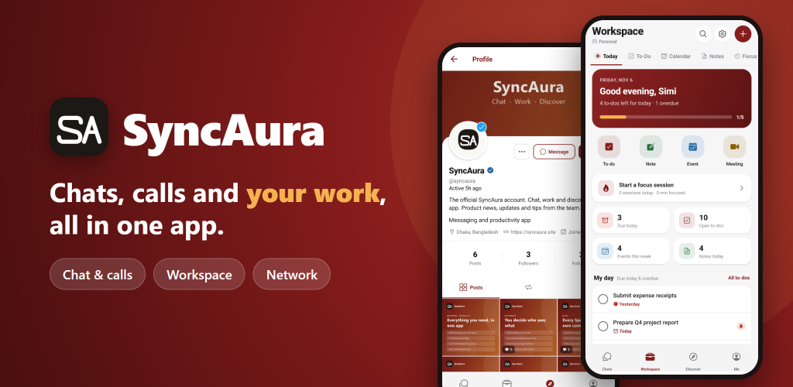

  

  

  
  
  

---

### ✳ A little about me

I taught myself to code, and honestly, I'm still learning every day.

I like taking things apart to see how they work, then building my own version. That's how I ended up making apps, playing with AI, and running my own servers instead of just using someone else's.

Most of my code is private for now, but I'm happy to show you around. If something here catches your eye, just say hi.

### ✳ What I'm building

<table>
  <tr>
    <td width="50%" valign="top">
       
      <b><a href="https://www.syncaura.site/">SyncAura</a></b> &nbsp;<code>CHAT · WORK · DISCOVER</code> 
      Chats, calls and your work, all in one app. Message friends, plan your day and find your people, without switching apps. 
      React Native · Expo · Node.js · Socket.IO 
      <a href="https://www.syncaura.site/">syncaura.site ↗</a>
    </td>
    <td width="50%" valign="top">
      <b>SI-Agent</b> &nbsp;<code>PERSONAL AI</code> 
      My own AI assistant. It runs on my computer and understands both Bangla and English. 
      Python
        
      <b>Sifat.cloud</b> &nbsp;<code>SELF-HOSTED</code> 
      My own little cloud. I use it to put my projects online and keep an eye on them. 
      TypeScript · Docker · Linux
        
      <b>CogNova 3.0</b> &nbsp;<code>AI RESEARCH</code> 
      Me learning how AI language models are made, starting from the data up. 
      Python
    </td>
  </tr>
</table>

Want to see more? Everything lives on <a href="https://sifat.email">sifat.email</a>.

### ✳ Tools I use

  

---

© 2026 Sifat Ahmed · All rights reserved · Please don't reuse my photo, banner or screenshots without asking.

