  

  

  
  
  

---

### ✳ A little about me 

I taught myself to code, and honestly, I'm still learning every day.

I like taking things apart to see how they work, then building my own version. That's how I ended up making apps, playing with AI, and running my own servers instead of just using someone else's.

Most of my code is private for now, but [BOS](https://github.com/hellosifat-dev/Bos) and the project websites below are open source, and I'm happy to show you around the rest. If something here catches your eye, just say hi.

### ✳ What I'm building

  
  
  
  
  
  
  

### ✳ Where to find them

<table>
  <tr><th align="left">Project</th><th align="left">What it is</th><th align="left">Website</th><th align="left">Site source</th></tr>
  <tr><td><b>SyncAura</b></td><td>Chat, work and discover in one app</td><td><a href="https://www.syncaura.site/">syncaura.site</a></td><td>private</td></tr>
  <tr><td><b>Sifat.cloud</b></td><td>A home for everything you build, on your own servers</td><td><a href="https://about.sifat.cloud/en/">about.sifat.cloud</a> · <a href="https://sifat.cloud/">panel</a></td><td>private</td></tr>
  <tr><td><b>CogNova 3.0</b></td><td>A language model I'm building from scratch</td><td><a href="https://cognova.sifat.codes/">cognova.sifat.codes</a></td><td><a href="https://github.com/hellosifat-dev/cognova-site">cognova-site</a></td></tr>
  <tr><td><b>Cognova Mail</b></td><td>Self-hosted email for people, teams and developers</td><td><a href="https://mail.sifat.codes/">mail.sifat.codes</a> · <a href="https://mail-demo.sifat.codes/">live demo</a></td><td><a href="https://github.com/hellosifat-dev/cognova-mail-site">cognova-mail-site</a></td></tr>
  <tr><td><b>FrameNest</b></td><td>Video and creator platform for Bangladesh</td><td><a href="https://framenest.sifat.codes/">framenest.sifat.codes</a></td><td><a href="https://github.com/hellosifat-dev/framenest-site">framenest-site</a></td></tr>
  <tr><td><b>BOS</b></td><td>Business OS: POS, inventory, HR and accounting</td><td><a href="https://bos.sifat.codes/">bos.sifat.codes</a></td><td><a href="https://github.com/hellosifat-dev/bos-site">bos-site</a> · <a href="https://github.com/hellosifat-dev/Bos">app</a></td></tr>
  <tr><td><b>SI-Agent</b></td><td>My AI assistant, running on my own server</td><td><a href="https://agent.sifat.codes/">agent.sifat.codes</a></td><td>private</td></tr>
</table>

SI-Agent runs on my own server, so it only answers while that server is online. Want to see more? My portfolio lives on <a href="https://sifat.email">sifat.email</a>.

### ✳ Tools I use

  

---

© 2026 Sifat Ahmed · All rights reserved · Please don't reuse my photo, banner or screenshots without asking.

