  

  

  
  
  

---

### ✳ About

I'm a self-taught software developer. I build apps, explore AI, and run the systems behind them — I like understanding how the whole thing works, end to end.

### ✳ Selected work

<table>
  <tr>
    <td width="50%" valign="top">
      <code>01 · MESSAGING / MOBILE &amp; WEB</code> 
      <b>SyncAura</b> 
      Social messaging across mobile and web — real-time conversations, contacts and calling. 
      React Native · Expo · Node.js · Socket.IO
    </td>
    <td width="50%" valign="top">
      <code>02 · PERSONAL AI / LOCAL-FIRST</code> 
      <b>SI-Agent</b> 
      A local-first AI assistant in Bengali and English, with project access and local read-aloud. 
      Python · Local-first AI · Voice
    </td>
  </tr>
  <tr>
    <td width="50%" valign="top">
      <code>03 · AI / RESEARCH</code> 
      <b>CogNova 3.0</b> 
      AI research on synthetic data, tokenizers and model correctness checks. 
      Python · Tokenization · Data provenance
    </td>
    <td width="50%" valign="top">
      <code>04 · INFRASTRUCTURE / SELF-HOSTED</code> 
      <b>Sifat.cloud</b> 
      My self-hosted deployment and management platform, with monitoring and logging built in. 
      TypeScript · Docker · Linux
    </td>
  </tr>
</table>

Most of my source is private. Explore everything at <a href="https://sifat.email">sifat.email</a> — happy to walk you through any of it.

### ✳ Toolkit

  

### ✳ Activity

  

